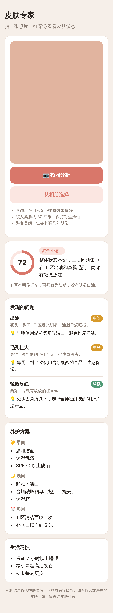

# 皮肤专家

用手机原生相机拍一张皮肤照片，AI 分析肤质、指出皮肤问题并给出养护建议。

- **手机 App**：在 [`mobile/`](mobile/README.md)，React Native + Expo，支持 iOS 和安卓。
- **分析服务**：本目录的 `server.js`，App 和网页版都调用它。
- **网页版**：`public/`，同一个服务直接提供，可以在手机浏览器里用。

- 前端：移动端网页（`public/index.html`），可"添加到主屏幕"像 App 一样使用。点「拍照分析」直接调起手机原生相机（前置），也可以从相册选图。图片在手机端压缩到最长边 1568px 再上传。
- 后端：`server.js`，Node 18+，只依赖 `@anthropic-ai/sdk`。接口 `POST /api/analyze` 接收 `{ image: "data:image/jpeg;base64,..." }`，调用 Claude 视觉模型（默认 `claude-opus-5-5`），用 JSON Schema 结构化输出返回：照片是否可用、肤质及依据、整体评分、问题列表（部位、轻微/中等/明显）、早晚/每周养护方案、生活习惯建议、是否建议就医。
- 页面底部有"仅供护肤参考，不构成医疗诊断"提示；照片不合格时会提示用户重拍。

## 运行

```bash
npm install

# 演示模式：不调用 AI，返回固定示例结果，用来看界面
npm run demo

# 正式模式：需要 Anthropic API key
ANTHROPIC_API_KEY=sk-ant-... npm start
```

打开 http://localhost:3000 。

### 在手机上试

1. 电脑和手机连同一个 Wi-Fi，运行 `npm start`。
2. 手机浏览器打开 `http://<电脑局域网 IP>:3000`，点「拍照分析」。

如果要发给别人用，把它部署到任何支持 Node 的平台（如 Render、Railway、Fly.io、阿里云/腾讯云服务器），设置环境变量 `ANTHROPIC_API_KEY` 即可。

## 环境变量

| 变量 | 说明 | 默认 |
| --- | --- | --- |
| `ANTHROPIC_API_KEY` | Anthropic API key | 必填（演示模式除外） |
| `CLAUDE_MODEL` | 使用的模型 | `claude-opus-5-5` |
| `PORT` | 端口 | `3000` |
| `MOCK` | 设为 `1` 时返回示例数据 | 关闭 |

请求开启了服务端 fallback（`fallbacks: "default"`），模型拒绝时会自动换模型重试；仍被拒绝时提示用户换一张照片。


